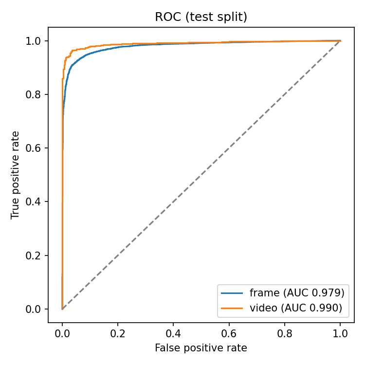
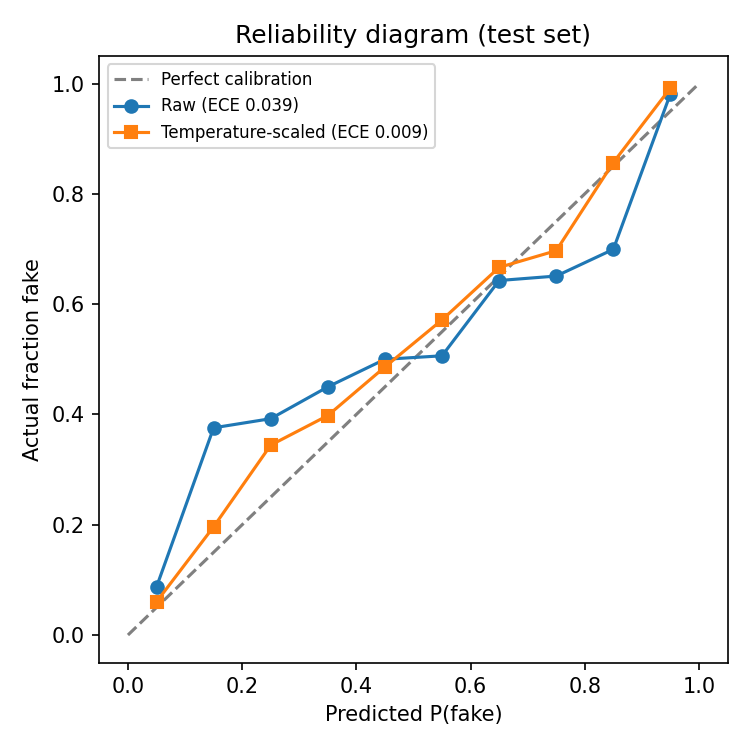

# Deepfake Detector

Detects deepfake face manipulations in images. Upload a photo with a face and get back:

- a **calibrated probability** that the face is manipulated, with an explicit "uncertain" zone instead of a forced yes/no
- a **Grad-CAM heatmap** showing which parts of the face drove the prediction

**Stack:** PyTorch · OpenCV · FastAPI · Docker · Next.js · Modal · GitHub Actions

> **Scope:** trained on [FaceForensics++](https://github.com/ondyari/FaceForensics) and [Celeb-DF v2](https://github.com/yuezunli/celeb-deepfakeforensics) face manipulations.
> It detects manipulated faces. It is not built to catch fully AI-generated images (Midjourney, Stable Diffusion) or general photo edits.

<!-- Add a demo GIF here once it's deployed:  -->

## Quick start (Docker)

Runs the API and the web app together with one command. No Python or Node setup needed.

1. Install [Docker Desktop](https://www.docker.com/products/docker-desktop/) and open it.
2. Get the trained model. The checkpoint isn't in git, so either put `best.pth` in `model/checkpoints/`, or set `MODEL_URL` to a download link for it (e.g. a GitHub Release asset) and the API fetches it on first start.
3. From the repo folder:

   ```bash
   docker compose up            # add --build after changing code
   # or, with MODEL_URL:
   MODEL_URL=https://.../best.pth docker compose up
   ```

4. Open http://localhost:3000. The API is at http://localhost:8000 (docs at `/docs`).

The web app starts once the API reports the model is loaded. Stop everything with `Ctrl+C`, or `docker compose down` if you started it with `-d`.

## Results

All numbers are on the datasets' official test splits (Celeb-DF v2: 518 videos; FF++ c23: 140 source videos x 5 = 700 videos). ResNet50, 6 epochs, trained on a Colab T4. Raw numbers are in `reports/*/metrics.json`.

### Generalization: does a detector work on data it wasn't trained on?

Video-level AUC (frame scores averaged per video). Italic cells are cross-dataset: the model never saw that dataset.

| Trained on ↓ / Tested on → | FF++ (c23) | Celeb-DF v2 |
|---|---|---|
| A: Celeb-DF only | *0.633* | 0.9995 |
| B: FF++ only | 0.987 | ***0.852*** |
| C: FF++ + Celeb-DF (deployed) | 0.983 | 0.9995 |

**Key findings**

- **Near-perfect in-dataset scores hide a generalization gap.** Model A scores 0.9995 on Celeb-DF but only 0.633 on FF++, barely better than chance. Model B drops from 0.987 on FF++ to 0.852 on unseen Celeb-DF.
- **The gap is asymmetric, and training diversity explains it.** FF++ contains four different manipulation methods (two face swaps, two expression reenactments); Celeb-DF has one. The model trained on the more varied data (B) transfers far better (0.852) than the one trained on a single method (A, 0.633).
- **Model A fails confidently, not randomly.** On FF++ it calls 92% of fake videos real, and its calibration error is 0.69 (vs 0.007 in-dataset). It scores *below chance* on FaceSwap (0.457 AUC). Temperature scaling fit on in-distribution data does not fix confidence under distribution shift.
- **Training on both datasets costs almost nothing.** Model C matches A on Celeb-DF (0.9995) and is within 0.004 of B on FF++.

### Per manipulation method (FF++ test split)

| Method | Type | A (trained on Celeb-DF) | B (trained on FF++) | C (deployed) |
|---|---|---|---|---|
| Deepfakes | face swap | 0.822 | 0.996 | 0.994 |
| FaceSwap | face swap | 0.457 | 0.994 | 0.993 |
| Face2Face | reenactment | 0.657 | 0.990 | 0.985 |
| NeuralTextures | reenactment | 0.595 | 0.970 | 0.960 |

Video-level AUC. NeuralTextures is the hardest method for the models trained on FF++ (B and C), consistent with the FF++ paper; it changes only the mouth region and leaves few visible artifacts. Model A, which never saw FF++, struggles most with FaceSwap.

### Deployed model (C), both test sets combined

| Level | AUC | Accuracy | Precision (fake) | Recall (fake) | F1 (fake) |
|---|---|---|---|---|---|
| Frame | 0.979 | 0.938 | 0.965 | 0.951 | 0.958 |
| Video | 0.990 | 0.961 | 0.978 | 0.970 | 0.974 |

**Calibration:** expected calibration error drops from 0.039 (raw) to 0.009 after temperature scaling (T = 1.93).

**Robustness** (frame AUC under degradations the model may meet in the wild):

| Condition | A (Celeb-DF test) | C (both test sets) |
|---|---|---|
| Clean | 0.996 | 0.979 |
| JPEG quality 70 | 0.995 | 0.973 |
| JPEG quality 50 | 0.994 | 0.964 |
| JPEG quality 30 | 0.989 | 0.946 |
| Downscaled 0.5x | 0.995 | 0.963 |
| Downscaled 0.25x | 0.980 | 0.913 |
| Blur (r = 1.5) | 0.994 | 0.962 |

Heavy downscaling is the most damaging degradation: small faces lose the fine detail detectors rely on.

| ROC (deployed model) | Calibration (deployed model) |
|---|---|
|  |  |

## How it works

```
image ─► YuNet face detector ─► square crop (1.3x margin, 256px)
      ─► ResNet50 / EfficientNet (fine-tuned, single "fake" logit)
      ─► sigmoid(logit / T)  ← temperature T fit on validation set
      ─► Grad-CAM on last conv block ─► heatmap overlay
```

### Data pipeline (`model/prepare_frames.py`)

- **Splits by identity, not by frame.** Celeb-DF reuses the same 59 celebrities across videos. If frames from the same person end up in train and val, the model memorizes faces and validation looks better than it is. Val is every video involving a held-out set of identities. A fake that involves a held-out person, even as the swap source, goes to val.
- **Official test list.** `List_of_testing_videos.txt` is used as the Celeb-DF test set so numbers are comparable to published results. (Note: the official test set shares identities with training videos. That's the benchmark's protocol, not a leak introduced here.)
- **FF++ uses its official split files** (`model/splits/`, 720/140/140 source videos). A fake made from videos A and B goes in the same split as A and B, so no person crosses splits. All four manipulation methods (Deepfakes, Face2Face, FaceSwap, NeuralTextures) at c23 compression.
- **Face crops, not full frames.** Training on full frames teaches the model about backgrounds and lighting. Cropping forces it to look at the face. The same `model/faces.py` code crops faces at training and inference time, so the model never sees a different kind of input in production.
- 10 evenly spaced frames per video by default.

### Training (`model/train.py`)

- ImageNet-pretrained backbone, last layer replaced with one logit. BCE loss.
- **Balanced sampling.** Celeb-DF has ~6x more fake than real videos, so a model that always says "fake" scores ~86% accuracy. A weighted sampler shows real and fake crops equally often, and AUC (not accuracy) is the selection metric.
- **Robustness augmentations:** random JPEG re-compression, downscaling and blur on top of standard crops and flips, so the model doesn't depend on fine artifacts that compression destroys.
- AdamW, one-cycle LR schedule, mixed precision on GPU, early stopping on validation AUC.

### Calibration (`model/calibration.py`)

Neural nets are usually overconfident: a raw "99%" can be right much less often than that. After training, one scalar temperature **T** is fit on the validation set by minimizing log loss of `sigmoid(logit / T)`. This changes how confident the model claims to be, never which class it picks. Reported as expected calibration error (ECE) plus a reliability diagram.

### Explanations (`model/gradcam.py`)

Grad-CAM, implemented from scratch with forward hooks: weight the last conv block's feature maps by the gradient of the output, sum them, ReLU, upsample. The heatmap shows evidence for whichever answer the model gave.

### Evidence and reliability (`model/explain.py`)

- **Where the model looked:** the Grad-CAM heatmap is split into face regions built from the detector's five landmarks (eyes, nose, mouth, rest of the face, outside the face), and the API reports the share of the heatmap in each.
- **How much to trust it:** the API flags uploads that the robustness tests showed are harder: small faces, blur (Laplacian variance below what the training crops have), a low-confidence face detection, or several faces in one photo.

### API (`app/`)

| Endpoint | Description |
|---|---|
| `GET /health` | Liveness, and whether a model is loaded |
| `GET /model-info` | Architecture, temperature, validation metrics |
| `POST /predict` | Multipart image upload, returns the result below |

```json
{
  "verdict": "likely_fake | uncertain | likely_real",
  "prob_fake": 0.83,
  "raw_prob_fake": 0.97,
  "face_box": { "x": 480, "y": 112, "w": 83, "h": 116, "score": 0.94 },
  "face_crop": "data:image/png;base64,...",
  "heatmap": "data:image/png;base64,...",
  "heatmap_explains": "fake",
  "attention": [{ "region": "mouth", "share": 0.41 }, { "region": "rest_of_face", "share": 0.27 }, "..."],
  "quality": { "face_px": 212, "sharpness": 31.4, "detector_confidence": 0.97, "faces_in_image": 1, "notes": [] },
  "model": { "arch": "resnet50", "temperature": 1.8 },
  "latency_ms": 412.0
}
```

Errors: `415` wrong file type, `413` too large, `400` unreadable, `422` no face found, `503` no model loaded.

## Development setup

For working on the code, training, or running without Docker.

### 1. Setup

```bash
python3 -m venv .venv && source .venv/bin/activate
pip install -r requirements-dev.txt
```

### 2. Build the face-crop datasets (on your machine, ~15–30 min each)

```bash
python -m model.prepare_frames --celeb-df-root ~/Documents/Celeb-DF-v2   # -> data/faces
python -m model.prepare_frames --ffpp-root ~/Documents/FaceForensics     # -> data/faces_ffpp
```

FF++ is downloaded with the official script (request access from the FF++ authors first):
`python download_faceforensics.py ~/Documents/FaceForensics -d <original|Deepfakes|Face2Face|FaceSwap|NeuralTextures> -c c23 -t videos --server EU2`

Each writes crops to `<dir>/{train,val,test}/{real,fake}/` and a `<dir>/manifest.csv`. Re-runnable: finished videos are skipped. Add `--limit-per-source 10` for a quick trial run.

### 3. Train (GPU: use the Colab notebook)

Training on a laptop CPU is too slow. Zip `data/faces`, upload it to Google Drive, and run [`notebooks/train_colab.ipynb`](notebooks/train_colab.ipynb) on a free T4 GPU. Or, on any machine with a GPU:

```bash
python -m model.train --data-dir data/faces data/faces_ffpp --arch resnet50 --epochs 6 --batch-size 64
python -m model.eval  --data-dir data/faces data/faces_ffpp --checkpoint-path model/checkpoints/best.pth
```

`--data-dir` takes one or more dataset folders. Several folders means train (or evaluate) on them combined, and eval then also prints AUC per dataset and per manipulation method.

Put the trained checkpoint at `model/checkpoints/best.pth`.

### 4. Run the API and frontend

```bash
uvicorn app.main:app --reload                       # http://localhost:8000/docs
cd frontend && cp .env.example .env.local && npm install && npm run dev   # http://localhost:3000
```

### 5. Tests

```bash
pytest -q
```

Tests build a small random-weight checkpoint, so they run without the real model or dataset. CI runs them, builds the frontend, and builds both Docker images on every push.

## Deployment

**Backend on Modal** (serverless, scales to zero, free when idle):

```bash
pip install modal && modal setup
ALLOWED_ORIGINS=https://your-app.vercel.app modal deploy deploy/modal_app.py
```

**Or with Docker** (Render, Railway, Fly, anywhere):

```bash
docker build -t deepfake-detector .
docker run -p 8000:8000 -v "$(pwd)/model/checkpoints:/app/model/checkpoints" deepfake-detector
```

The checkpoint isn't in git. Either mount it as above, or upload it as a GitHub Release asset and set `MODEL_URL` so the container downloads it on first start.

**Frontend on Vercel:** import the repo, set the root directory to `frontend`, and set `NEXT_PUBLIC_API_URL` to the backend URL.

## Configuration

| Env var | Default | Purpose |
|---|---|---|
| `MODEL_CHECKPOINT` | `model/checkpoints/best.pth` | Checkpoint path |
| `MODEL_URL` | (empty) | Download the checkpoint from here if missing |
| `ALLOWED_ORIGINS` | `http://localhost:3000` | Comma-separated CORS origins |
| `DECISION_MARGIN` | `0.7` | P(fake) ≥ this is "likely fake", ≤ 1 − this is "likely real" |
| `MAX_UPLOAD_SIZE_MB` | `10` | Upload limit |

## Limitations

- Trained on two academic datasets of face manipulations in video. Expect worse performance on newer deepfake methods, on fully synthetic images, and on very different demographics or settings (the cross-dataset table shows how big that drop can be).
- Frames come from video, so single photos taken with modern phone cameras are somewhat out of distribution.
- Only the largest face in an image is analyzed.
- Grad-CAM shows where the model looked, not a proven artifact. Heatmaps for deepfake detectors are often diffuse.
- This is a screening aid. It should never be the only evidence that an image is or isn't real.

## Project layout

```
app/            FastAPI service (main.py, inference.py, schemas.py, config.py)
model/          faces.py, prepare_frames.py, dataset.py, transforms.py, model_utils.py,
                train.py, eval.py, calibration.py, gradcam.py, metrics.py
model/weights/  YuNet face detector (230 KB, from OpenCV Zoo)
model/splits/   Official FF++ train/val/test split files
frontend/       Next.js upload UI
notebooks/      Colab training notebook
deploy/         Modal deployment
tests/          pytest suite
reports/        metrics.json and plots written by train/eval
```

## Acknowledgements

- Celeb-DF v2: Li et al., "Celeb-DF: A Large-scale Challenging Dataset for DeepFake Forensics", CVPR 2020.
- FaceForensics++: Rössler et al., "FaceForensics++: Learning to Detect Manipulated Facial Images", ICCV 2019.
- Both datasets are for research use and are not redistributed here.
- YuNet face detector from [OpenCV Zoo](https://github.com/opencv/opencv_zoo).
- Grad-CAM: Selvaraju et al., ICCV 2017. Temperature scaling: Guo et al., "On Calibration of Modern Neural Networks", ICML 2017.
